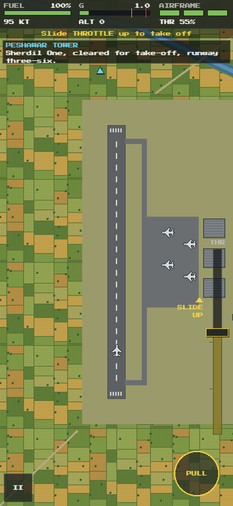
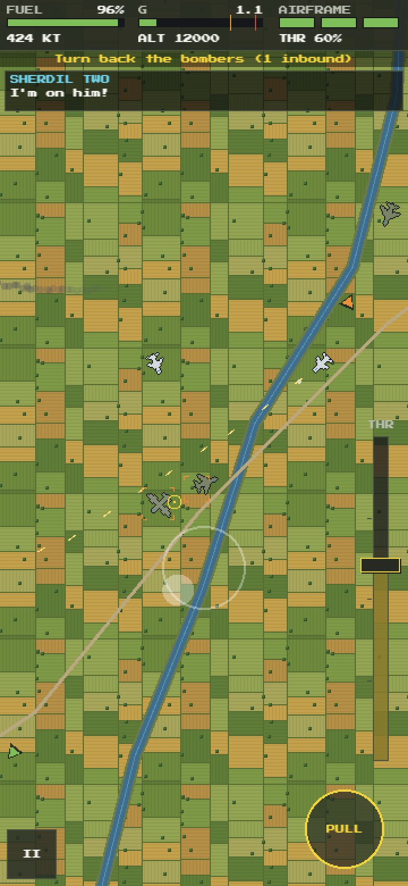
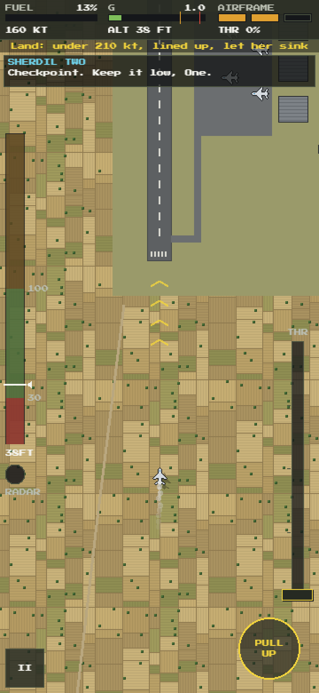
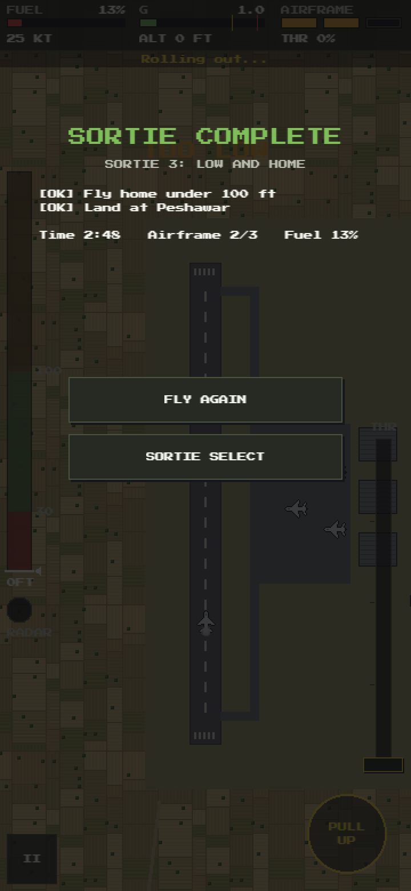

# Wings of Freedom: The Legend of Matiur Rahman

A mobile-first pixel-art game about Flight Lieutenant Matiur Rahman (1941–1971), Bir Shreshtho. It tells his life in five short episodes: three story episodes and two playable ones. The ending is fixed by history. The game aims for respect, not spectacle.

> **Status:** Episode 2, *Sabre Skies* (September 1965), is playable on phones as a mechanics build on the
> [`stage-2-game-dev`](https://github.com/jawadefaj/matiur/tree/stage-2-game-dev) branch. It uses placeholder art and has no sound yet.

## Screenshots

Episode 2 on a phone (portrait, 360 px wide, shown at 2×):

<table>
  <tr>
    <td align="center" width="25%"><br><sub>Sortie select</sub></td>
    <td align="center" width="25%"><br><sub>Sortie 1: take-off roll at Peshawar</sub></td>
    <td align="center" width="25%"><br><sub>Sortie 1: joining Sherdil Two's wing</sub></td>
    <td align="center" width="25%"><br><sub>Sortie 2: gunsight on a bomber</sub></td>
  </tr>
  <tr>
    <td align="center"><br><sub>Sortie 2: a hit fighter breaks off. The dark edges are G strain.</sub></td>
    <td align="center"><br><sub>Sortie 3: climbing over a ridge, under 100 ft</sub></td>
    <td align="center"><br><sub>Sortie 3: final approach</sub></td>
    <td align="center"><br><sub>Scored on objectives only, no kill count</sub></td>
  </tr>
</table>

## Episode 2: Sabre Skies

| Sortie | What it covers |
|---|---|
| 1. Scramble | Take-off, steering, throttle, joining formation, a short patrol |
| 2. Intercept | Gunsight, G-meter, turning back bombers, protecting a friendly formation |
| 3. Low and Home | Flying under 100 ft to stay off radar, fuel, landing |

Hit aircraft trail smoke and break off; nothing explodes. The flight engine and low-level flying built here are reused in Episode 4.

## Run it

Needs Node 20+.

```bash
git clone https://github.com/jawadefaj/matiur.git
cd matiur
git checkout stage-2-game-dev
npm install
npm run dev
```

Open the `Network:` address it prints (for example `http://192.168.0.196:5173`) on your phone. The phone must be on the same Wi-Fi.
If the phone can't connect, Windows Firewall is probably blocking Node on a *Public* network. Set the Wi-Fi network to *Private*, or allow Node.js through the firewall.

`?sortie=1`, `?sortie=2` or `?sortie=3` on the URL jumps straight into a sortie.

```bash
npm test          # unit tests + bot pilots that fly every sortie
npm run build     # static build in dist/ (Phaser loads from the jsDelivr CDN)
```

## Controls

| Phone | Desktop | Does |
|---|---|---|
| Drag anywhere | Arrow keys | Steer: the jet turns toward the drag |
| THROTTLE slider (right edge) | W / S | Speed and fuel burn |
| PULL | Space | Tighter turn and more G. In sortie 3 it climbs. |
| (automatic) | | Guns fire when the sight is on a target. Set GUNS: HOLD for a FIRE button. |
| II | P / Esc | Pause |

## Tuning

Every gameplay number is in [src/data/tuning.json](src/data/tuning.json): speeds, G limits, fuel burn, damage, guns, AI and the low-level band.

## Folder structure

```
matiur/
├── index.html            The web page that loads the game
├── vite.config.ts        Dev server and build settings
├── package.json          npm scripts and dependencies (Phaser, TypeScript, Vite, Vitest)
├── tsconfig.json         TypeScript settings
├── assets/               Every non-code file: icon, reference photos, reading, screenshots
│   ├── public/           App icon and web-app manifest, copied into the build
│   ├── sprites/          PNG game art; each file replaces one placeholder
│   ├── reference/        Research photos and reading for art and writing (never shipped)
│   └── screenshots/      The images in this README
├── design/               Game Design Document and build spec
├── src/                  Game code (TypeScript)
│   ├── main.ts           Starts Phaser and lists the scenes
│   ├── config.ts         Screen size, palette, font and other shared constants
│   ├── save.ts           Progress and settings, saved in the browser (localStorage)
│   ├── data/             tuning.json: every gameplay number
│   ├── gfx/              Game art: loads PNGs from assets/sprites/, else draws placeholders in code
│   ├── scenes/           Phaser scenes: boot, sortie menu, flight, HUD and touch controls
│   ├── sim/              The simulation: aircraft, bullets and events, stepped 60 times a second
│   ├── systems/          Flight model, G-meter, fuel, damage, low-level flight, guns, AI, radio
│   ├── sortie/           The three Episode 2 sorties and their terrain
│   └── ui/               Pixel-font text and button helpers
├── tests/                Unit tests and bot pilots that fly every sortie
└── .claude/launch.json   Dev and preview server settings for Claude Code
```

`node_modules/` (from `npm install`) and `dist/` (from `npm run build`) are created locally and are not committed.

The code in `sim/`, `systems/` and `sortie/` doesn't use Phaser, so the tests can fly every sortie without a browser. The scenes in `scenes/` draw that simulation and read the touch and keyboard input.

**Where new things go**

| Adding | Put it in |
|---|---|
| Game art (PNG) | `assets/sprites/`, named after the texture key. See [assets/sprites/README.md](assets/sprites/README.md). |
| A gameplay number | [src/data/tuning.json](src/data/tuning.json) |
| A sortie | `src/sortie/`, then add it to `SORTIE_LIST` and `makeSortie` in [src/sortie/index.ts](src/sortie/index.ts) |
| A research photo or article | `assets/reference/`, with its source recorded in [assets/README.md](assets/README.md) |
| Real art, audio or fonts (later) | The planned folders under `assets/`, listed in [assets/README.md](assets/README.md) |
| A README screenshot | `assets/screenshots/` |

## Design

- [Game Design Document](<design/Game Design Document - Wings of Freedom.md>): rev 3.1, the source of truth for story, structure, tone and history.
- [Build spec](design/init_design.md): tech, systems, tuning and code layout.
- [Assets guide](assets/README.md): what's in `assets/`, where each reference file came from, and which ones to review.
