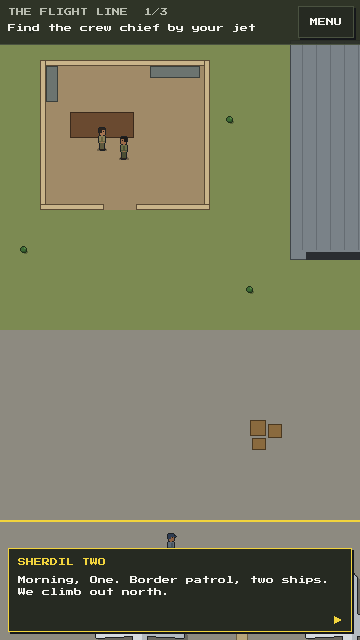

# Wings of Freedom: The Legend of Matiur Rahman

A mobile-first pixel-art game about Flight Lieutenant Matiur Rahman (1941–1971), Bir Shreshtho. It tells his life in five short episodes: three story episodes and two playable ones. The ending is fixed by history. The game aims for respect, not spectacle.

> **Status:** Episode 2, *Sabre Skies* (September 1965), is playable on phones as a mechanics build: the
> on-foot flight line, three sorties, placeholder between-sortie scenes and an archive card. It uses placeholder art and has no sound yet.
> The game runs from a game script: episodes are written as lists of steps in [src/game/](src/game/) and played by a game manager.

## Screenshots

Episode 2 on a phone (portrait, 360 px wide, shown at 2×):

<table>
  <tr>
    <td align="center" width="25%"><br><sub>Sortie select</sub></td>
    <td align="center" width="25%"><br><sub>Sortie 1: take-off roll at Peshawar</sub></td>
    <td align="center" width="25%"><br><sub>Sortie 1: joining Sherdil Two's wing</sub></td>
    <td align="center" width="25%"><br><sub>Sortie 2: gunsight on a bomber</sub></td>
  </tr>
  <tr>
    <td align="center"><br><sub>Sortie 2: a hit fighter breaks off. The dark edges are G strain.</sub></td>
    <td align="center"><br><sub>Sortie 3: climbing over a ridge, under 100 ft</sub></td>
    <td align="center"><br><sub>Sortie 3: final approach</sub></td>
    <td align="center"><br><sub>Scored on objectives only, no kill count</sub></td>
  </tr>
</table>

## Episode 2: Sabre Skies

| Sortie | What it covers |
|---|---|
| 1. Scramble | Take-off, steering, throttle, joining formation, a short patrol |
| 2. Intercept | Gunsight, G-meter, turning back bombers, protecting a friendly formation |
| 3. Low and Home | Flying under 100 ft to stay off radar, fuel, landing |

Hit aircraft trail smoke and break off; nothing explodes. The flight engine and low-level flying built here are reused in Episode 4.

## Run it

Needs Node 22.12 or newer (Vitest 5 requires it).

```bash
git clone https://github.com/jawadefaj/matiur.git
cd matiur
npm install
npm run dev
```

Open the `Network:` address it prints (for example `http://192.168.0.196:5173`) on your phone. The phone must be on the same Wi-Fi.
If the phone can't connect, Windows Firewall is probably blocking Node on a *Public* network. Set the Wi-Fi network to *Private*, or allow Node.js through the firewall.

Add these to the URL to jump somewhere (handy on a phone):

| URL | Opens |
|---|---|
| `?episode=ep2` | Episode 2 from its title card |
| `?level=ep2/sortie-2` | That step, then on through the episode. Add `&only=1` to return to the menu after it. |
| `?play=flight&sortie=2` | One sortie on its own: no episode, nothing saved |
| `?play=walk&map=flightline` | One on-foot level on its own |
| `?play=video&src=ep2_intro`, `?play=cutscene&script=ep2_beat_1` | Preview a video or a cutscene |
| `?unlock=all` | Dev builds: open every episode and chapter |

The old `?sortie=N` and `?walk=flightline` links still work. In a dev build (`npm run dev`), **N** finishes the current step, so you can click through a whole episode in a minute.

```bash
npm test          # unit tests, bot pilots that fly every sortie, game definition checks
npm run build     # static build in dist/ (Phaser loads from the jsDelivr CDN)
```

## Controls

| Phone | Desktop | Does |
|---|---|---|
| Drag anywhere | Arrow keys | Steer: the jet turns toward the drag |
| THROTTLE slider (right edge) | W / S | Speed and fuel burn |
| PULL | Space | Tighter turn and more G. In sortie 3 it climbs. |
| (automatic) | | Guns fire when the sight is on a target. Set GUNS: HOLD for a FIRE button. |
| II | P / Esc | Pause |

### On foot (walk mechanic)

Some parts of the game are played on foot: move a character from one place to another to reach a goal. The first is **The Flight Line** (Episode 2, chapter 1), the beat before Sortie 1: get the brief from Sherdil Two in the crew room, find the crew chief on his rounds by the jet, then walk out to your Sabre. It ends on FLY SORTIE 1.



| Phone | Desktop | Does |
|---|---|---|
| Tap the ground | | Walk there, finding a way round walls |
| Tap a person | | Walk over and talk to them |
| Drag | Arrow keys / WASD | Walk in that direction |
| Tap / TALK button | Space / E | Read the next line, or talk to whoever is near |

The same system moves non-player characters: scripts can send anyone along a path (`walk('two', ...)`), loop them on rounds (`setPatrol`), and chain moves, waits and dialogue into short scripted sequences. See [src/mechanics/walk/](src/mechanics/walk/).

## Tuning

Every gameplay number is in a mechanic's `tuning.json`, not in code:
- [src/mechanics/flight/tuning.json](src/mechanics/flight/tuning.json): speeds, G limits, fuel burn, damage, guns, AI and the low-level band.
- [src/mechanics/walk/tuning.json](src/mechanics/walk/tuning.json): walking speed, talk range and drag controls.

## How the game is put together

The game is a list of **episodes**, and each episode is a list of **steps** played in order. A step is one of:

| Step | Plays | Written as |
|---|---|---|
| Level | One level of a **mechanic** (flying, walking...) | `flight.level('sortie-1', { sortie: 1 })` |
| Video | A file from [assets/video/](assets/video/) | `video('intro', { src: 'ep2_intro' })` |
| Cutscene | An in-engine scene from [src/data/cutscenes/](src/data/cutscenes/) | `cutscene('beat-1', { script: 'ep2_beat_1' })` |
| Card | The title card (added automatically) or the closing archive card | `archiveCard('archive', { ... })` |

This is the game script for Episode 2, [src/game/episodes/ep2.sabre-skies.ts](src/game/episodes/ep2.sabre-skies.ts) (shortened):

```ts
export default defineEpisode({
  id: 'ep2', number: 2, title: 'Sabre Skies', date: 'September 1965', place: 'PAF Station Peshawar',
  unlock: 'always',
  steps: [
    video('intro', { src: 'ep2_intro', fallback: ['September 1965.'] }),
    walk.level('flight-line', { map: 'flightline' }),
    flight.level('sortie-1', { sortie: 1 }),
    cutscene('beat-1', { script: 'ep2_beat_1' }),
    flight.level('sortie-2', { sortie: 2 }),
    cutscene('beat-2', { script: 'ep2_beat_2' }),
    flight.level('sortie-3', { sortie: 3 }),
    archiveCard('archive', { cardId: 'ep2_sabre_skies', heading: 'Sabre Skies', text: '...' }),
  ],
});
```

The **game manager** ([src/core/manager/](src/core/manager/)) reads this, builds the menu (CONTINUE, chapters, settings), plays each step and saves progress. Game-wide settings are in [src/game/game.ts](src/game/game.ts). Each level's params are type-checked, so a typo such as `{ sortie: 4 }` fails the build, and the boot screen lists any problem in the definition.

Scenes never start each other. Each step's scene gets a **host** and tells it when the step is complete or failed, or that the player wants to retry or quit. The manager then decides what comes next, so the same walk or flight level can sit anywhere in any episode.

A **mechanic** is one folder in [src/mechanics/](src/mechanics/) with two entry files, found automatically:
- `index.ts`: what a level of it takes (its params), how to check them, and its settings. No Phaser, so the tests can load it.
- `runtime.ts`: its Phaser scenes and art.

See [src/mechanics/README.md](src/mechanics/README.md) for the contract and a template.

## Folder structure

```
matiur/
├── index.html            The web page that loads the game
├── vite.config.ts        Dev server and build settings
├── package.json          npm scripts and dependencies (Phaser, TypeScript, Vite, Vitest)
├── tsconfig.json         TypeScript settings
├── assets/               Every non-code file
│   ├── public/           App icon and web-app manifest, copied into the build
│   ├── sprites/          PNG game art; each file replaces one placeholder
│   ├── video/            Video files for video steps
│   ├── reference/        Research photos and reading for art and writing (never shipped)
│   └── screenshots/      The images in this README
├── design/               Game Design Document and build spec
├── src/
│   ├── main.ts           Starts the game from src/game/
│   ├── game/             THE GAME SCRIPT
│   │   ├── game.ts       Game-wide settings
│   │   └── episodes/     One file per episode: its steps in order
│   ├── core/             Shared by every mechanic
│   │   ├── manager/      The game manager: step order, deep links, definition checks
│   │   ├── scenes/       Boot, menu, title/archive cards, video, placeholder cutscene
│   │   ├── media/        Video player, and finding video and cutscene files
│   │   ├── gfx/          PNG loading, shared placeholder art (ground, tree), texture helpers
│   │   ├── ui/           Pixel-font text and button helpers
│   │   └── config.ts  save.ts  math.ts  contracts.ts  define.ts
│   ├── mechanics/        One folder per mechanic, found automatically
│   │   ├── flight/       Top-down jet flying: sim, systems, sorties, flight and HUD scenes
│   │   └── walk/         On foot: pathfinding, walkers, goals, dialogue, walk scene
│   └── data/cutscenes/   Cutscene scripts (JSON) for cutscene steps
├── tests/                Unit tests, bot pilots, game definition and architecture checks
└── .claude/launch.json   Dev and preview server settings for Claude Code
```

`node_modules/` (from `npm install`) and `dist/` (from `npm run build`) are created locally and are not committed.

Only scenes, `runtime.ts` files and the manager use Phaser. Everything else is plain TypeScript, so the tests can fly every sortie and play through every episode without a browser. [tests/architecture.test.ts](tests/architecture.test.ts) checks this, and checks that `core/` never imports a mechanic and that no mechanic imports another.

**Where new things go**

| Adding | Put it in |
|---|---|
| A step in an episode | That episode's file in [src/game/episodes/](src/game/episodes/) |
| A new episode | A new file in `src/game/episodes/` (`export default defineEpisode({...})`). It is found automatically. |
| A new mechanic | A new folder in `src/mechanics/` with `index.ts` and `runtime.ts`. See [src/mechanics/README.md](src/mechanics/README.md). |
| A video | [assets/video/](assets/video/), then a `video(...)` step. See [assets/video/README.md](assets/video/README.md). |
| A cutscene script | [src/data/cutscenes/](src/data/cutscenes/), then a `cutscene(...)` step |
| Game art (PNG) | `assets/sprites/`, named after the texture key. See [assets/sprites/README.md](assets/sprites/README.md). |
| A gameplay number | The mechanic's `tuning.json` |
| A sortie | `src/mechanics/flight/sortie/`, then add it to `SORTIE_LIST` and `makeSortie` in [sortie/index.ts](src/mechanics/flight/sortie/index.ts) |
| An on-foot level | `src/mechanics/walk/levels/` (a `WalkLevel` subclass, like `FlightLine.ts`), then add it to `WALK_LIST` and `makeWalkLevel` in [levels/index.ts](src/mechanics/walk/levels/index.ts) |
| A research photo or article | `assets/reference/`, with its source recorded in [assets/README.md](assets/README.md) |
| Real art, audio or fonts (later) | The planned folders under `assets/`, listed in [assets/README.md](assets/README.md) |
| A README screenshot | `assets/screenshots/` |

## Branches

`main` always holds the whole game: the game manager, every merged mechanic and the episode files. Work happens on branches that each touch their own folder, so they merge into `main` without conflicts:

| Branch | Works on | Leaves alone |
|---|---|---|
| `stage-2-game-dev` (flight, Episode 2) | `src/mechanics/flight/` and its tests | `src/core/`, other mechanics |
| `walking-mechanix` (walk) | `src/mechanics/walk/` and its tests | `src/core/`, other mechanics |
| `mechanic/<id>` (a new mechanic) | `src/mechanics/<id>/`, `tests/mechanics/<id>/` | `src/core/`, other mechanics |
| `cutscene/<episode>-<name>` | `src/data/cutscenes/`, `assets/video/`, the steps of one episode file | `src/core/`, mechanics |
| `core/<topic>` (one at a time) | `src/core/`, `src/main.ts` | content |

- New scene keys start with the mechanic id (`walk:Walk`). New texture keys should too (`walk_...`): the boot scene stops if two mechanics register the same key.
- Episode files list one step per line, so two branches adding steps rarely touch the same line.
- Merge `main` into a long-lived branch before opening a pull request. Use merge commits (not squash) for multi-commit work.
- `npm test` must pass: it checks the episode files and the architecture rules, and flies every sortie.

## Design

- [Game Design Document](<design/Game Design Document - Wings of Freedom.md>): rev 3.1, the source of truth for story, structure, tone and history.
- [Build spec](design/init_design.md): tech, systems, tuning and code layout.
- [Assets guide](assets/README.md): what's in `assets/`, where each reference file came from, and which ones to review.
