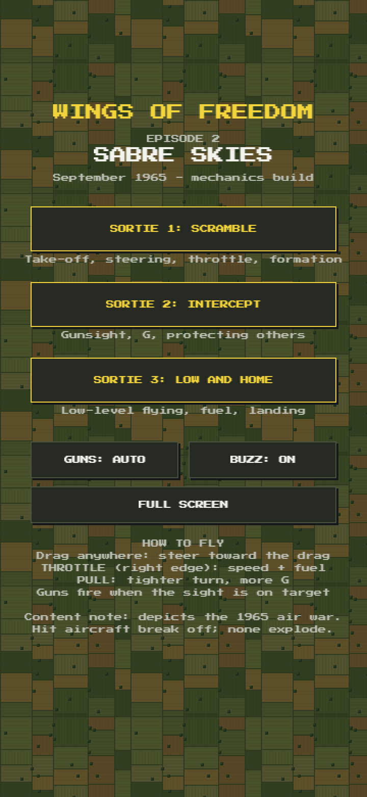
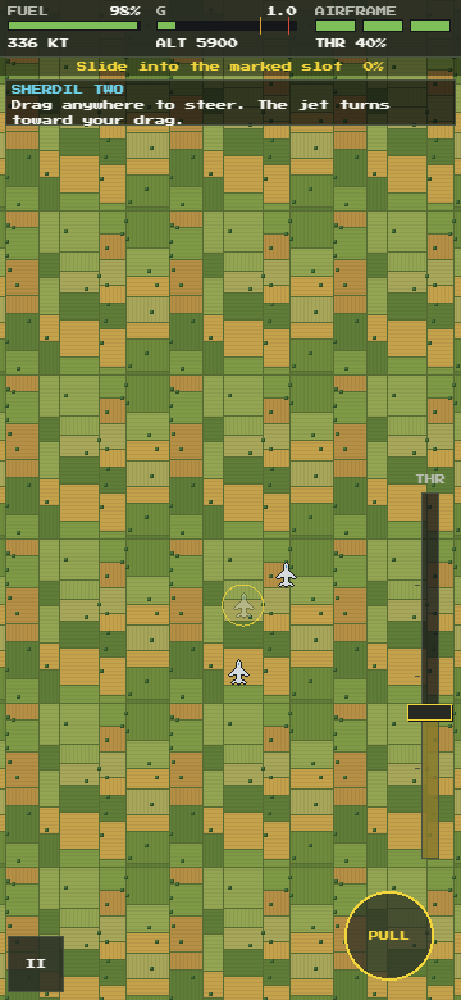
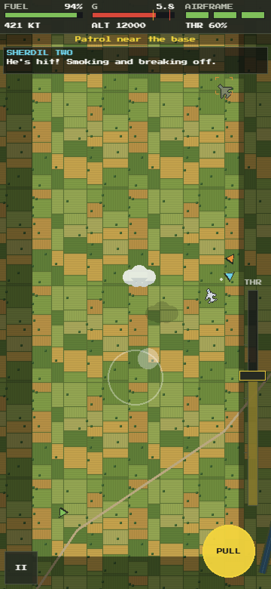
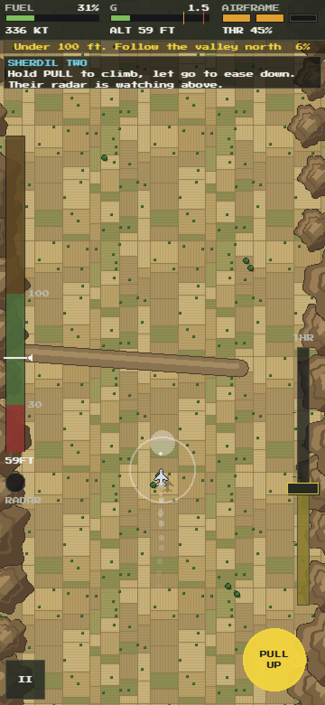

# Wings of Freedom: The Legend of Matiur Rahman

A mobile-first pixel-art game about Flight Lieutenant Matiur Rahman (1941–1971), Bir Shreshtho. It tells his life in five short episodes: three story episodes and two playable ones. The ending is fixed by history. The game aims for respect, not spectacle.

> **Status:** Episode 2, *Sabre Skies* (September 1965), is playable on phones as a mechanics build on the
> [`stage-2-game-dev`](https://github.com/jawadefaj/matiur/tree/stage-2-game-dev) branch. It uses placeholder art and has no sound yet.

## Screenshots

Episode 2 on a phone (portrait, 360 px wide, shown at 2×):

<table>
  <tr>
    <td align="center" width="25%"><br><sub>Sortie select</sub></td>
    <td align="center" width="25%"><br><sub>Sortie 1: take-off roll at Peshawar</sub></td>
    <td align="center" width="25%"><br><sub>Sortie 1: joining Sherdil Two's wing</sub></td>
    <td align="center" width="25%"><br><sub>Sortie 2: gunsight on a bomber</sub></td>
  </tr>
  <tr>
    <td align="center"><br><sub>Sortie 2: a hit fighter breaks off. The dark edges are G strain.</sub></td>
    <td align="center"><br><sub>Sortie 3: climbing over a ridge, under 100 ft</sub></td>
    <td align="center"><br><sub>Sortie 3: final approach</sub></td>
    <td align="center"><br><sub>Scored on objectives only, no kill count</sub></td>
  </tr>
</table>

## Episode 2: Sabre Skies

| Sortie | What it covers |
|---|---|
| 1. Scramble | Take-off, steering, throttle, joining formation, a short patrol |
| 2. Intercept | Gunsight, G-meter, turning back bombers, protecting a friendly formation |
| 3. Low and Home | Flying under 100 ft to stay off radar, fuel, landing |

Hit aircraft trail smoke and break off; nothing explodes. The flight engine and low-level flying built here are reused in Episode 4.

**Controls (phone):**
- Drag anywhere to steer.
- Slide THROTTLE on the right edge for speed.
- Hold PULL for a tighter turn. In sortie 3 it climbs.
- Guns fire on their own when the sight is on a target.

## Try it

Needs Node 20+.

```bash
git clone https://github.com/jawadefaj/matiur.git
cd matiur
git checkout stage-2-game-dev
npm install
npm run dev
```

Open the `Network:` address it prints on a phone on the same Wi-Fi. Run `npm test` for the unit tests and the bot pilots that fly every sortie.

## Design

On the `stage-2-game-dev` branch:

- [Game Design Document](https://github.com/jawadefaj/matiur/blob/stage-2-game-dev/design/Game%20Design%20Document%20-%20Wings%20of%20Freedom.md): rev 3.1, the source of truth for story, structure, tone and history.
- [Build spec](https://github.com/jawadefaj/matiur/blob/stage-2-game-dev/design/init_design.md): tech, systems, tuning and code layout.
