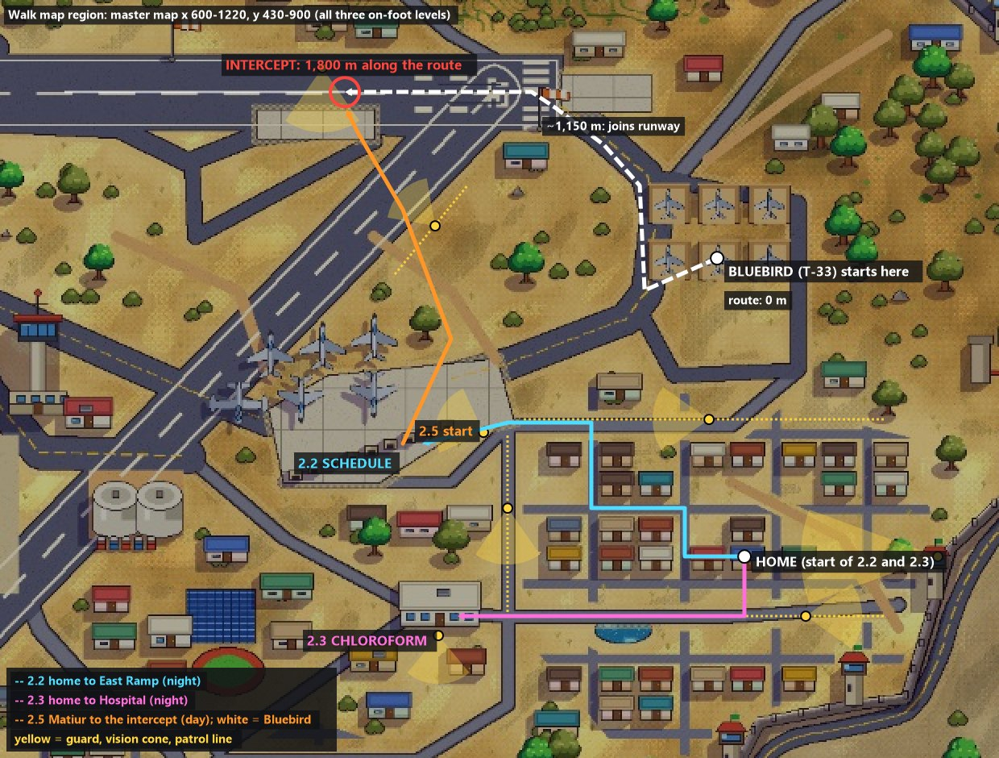

# Level 2 — Bluebird (plan)

The 20 August 1971 level, built from the art in [assets/sprites/original/](../assets/sprites/original/).
The game has **two levels** ([GDD §0](Game%20Design%20Document%20-%20Wings%20of%20Freedom.md#0-the-game-in-one-page)): **Level 1, Sabre Skies** (1965) and **Level 2, Bluebird** (this file). Level 2 is the stealth level. It opens with a video that carries the story on from Level 1. It has seven parts: three cinematics and four playable sections.

| # | Part | Kind | Where on the base | Length | Step id |
|---|---|---|---|---|---|
| 2.1 | Prologue | Cinematic: the bridge from Level 1 | 1965 → 1971, then the whole base | 4:00 | `prologue-1`, `prologue-2` |
| 2.2 | The Schedule | Stealth (on foot), **night** | Residential East → East Ramp | 2–3 min | `schedule` |
| 2.3 | The Dispensary | Stealth (on foot), **night** | Residential East → Hospital | 2–3 min | `dispensary` |
| 2.4 | Morning | Cinematic | Residential East, East Dispersal | 2:00 | `morning` |
| 2.5 | Intercept | Timed stealth (on foot) | East Ramp → end of the taxiway, 1,150 m mark | 1–2 min | `intercept` |
| 2.6 | Bluebird | Cinematic | Taxiway, take-off | 2:00 | `boarding` |
| 2.7 | Radar Horizon | Low-level flight | East of Karachi | ~1 min | `radar-horizon` |

**Total:** about 15–17 minutes, 8 of them cinematic. The GDD aims for 8–12 minutes of play per level, so the cinematics are where to trim if the level feels long. Every cinematic can be skipped (hold to skip).

**Decisions (18 Nov 2026)**
- The game is two levels. This is **Level 2**, not Episode 4. Ids use `level2`.
- The stealth parts 2.2 and 2.3 happen **at night**.
- Bluebird is stopped at the **1,150 m mark**, where the taxiway meets the runway. This is a trial: build it, look at it, then decide.

**First version (18 Nov 2026), playable now**
- The three on-foot parts (2.2, 2.3, 2.5) work end to end, with guards, torch cones, a detection meter, a RETRY card when caught, and Bluebird taxiing to the 1,150 m mark.
- Minimal art: the base map is one picture (night is a darkened copy), and Matiur, the guards and the T-33 are single still images moved with the arrow keys. No walk animation.
- Not yet: walls (cones see across buildings), running, the hold-to-take item, the hospital interior, 2.7 Radar Horizon, and the video clips (their steps show fallback text).
- Try a part on its own: `?play=walk&map=masroor-schedule`, `masroor-hospital` or `masroor-intercept`. Bluebird taxis at 36 px/s after a 4 s wait.

---

## 1. The map



Drawn on [airport-level-map-clean.jpeg](../assets/sprites/original/airport-level-map-clean.jpeg). The labelled copy gives the place names.

**One walk map for all three on-foot parts.** 2.2, 2.3 and 2.5 all happen in the same corner of the base: master-map x 600–1220, y 430–900. It is built once, as the GDD asks (§6.2), and each part uses different guards, a different start and a different goal.

**Scale**
- The runway with overruns is 3,387 m and about 600 px on the master map, so **1 map px ≈ 5.65 m**.
- The walk map is that region at **4×**: 2,480 × 1,880 world px. A house becomes about 64 × 48 px, roughly four characters wide.
- Distances shown to the player (Bluebird's metre counter, the 1,150 m mark) use **1 world px ≈ 1.41 m**. Sprites are drawn at readable sizes, not true scale, as on the Level 1 flight line.
- Walls and zones are written in master-map pixels and multiplied by 4 in code. Anyone can then read a coordinate straight off the map image and put it in the level.

---

## 2. What each uploaded image becomes

All uploads are JPEGs without transparency, drawn at high resolution. The sprite rules ([assets/sprites/README.md](../assets/sprites/README.md)) need PNGs with alpha at 1 image pixel = 1 game pixel. Each gameplay use needs a cut-out and a redraw at game size. A plain downscale turns JPEG noise into mush.

### Base map and theme

| File | What it actually shows | Use |
|---|---|---|
| `airport-level-map-clean` | The whole base, top-down pixel art | Layout source for the walk map. In 2.1, the "planning" shot: the map on Matiur's desk. |
| `airport-level-map-labeled` | Same, with English place names baked in | Design reference only. In-game labels are drawn by the engine on the clean map so they can be shown in Bangla too. |
| `airport-tileset-golden-warm` | Crisp pixel art, short midday shadows; matches the master map | **Master style.** Gameplay art and the daylight intercept (2.5, ~11:30 **[verify]**). Night versions for 2.2 and 2.3 are a tint of the same art. |
| `airport-tileset-brown-hangar` | Painterly, weathered roofs, long low-sun shadows | Colour reference for the dawn shots in 2.1 and 2.4. |
| `airport-tileset-orange-lighting` | 3D low-poly render, not pixel art | Lighting reference only. Using it in-game would mix styles (GDD §6.10). |
| `airport-tileset-green-border` | Pixel art, heavier outlines, round-roofed hangars | Alternate; not used. |
| `airport-tileset-grey-shadow` | Flat pixel art, dark cracked apron | Alternate; not used. |

**Gap:** all five theme images show the west and centre of the base (tower, shelter apron, Admin/HQ, fuel tanks). The playable parts are on the **east** side. The theme images work for the cinematics' establishing shots, but the east-side gameplay art (Residential East, East Ramp, Hospital, East Dispersal, the runway's east half) has to be made in the golden-warm style, using the master map as the layout.

### Characters and the aircraft

| File | Contents | Becomes |
|---|---|---|
| `character-matiur-turnaround` | Service dress (front, side, back, salute) and flight suit (front, side, back, helmet under arm) | Walk sheets `walk_matiur_uniform` (2.2, 2.3, 2.5) and `walk_matiur_flightsuit` (cinematics). The **salute** is the SIGNAL pose in 2.5; the **helmet** pose is the boarding in 2.6. The sheet has standing poses only: each direction needs two walking frames, and the side view faces right only (mirrored for left). |
| `character-matiur-frontface` | Portraits in both outfits: neutral, stern, worried, smiling, sunglasses up | Dialogue-box portraits in the on-foot parts; close-ups in the cinematics. |
| `character-rashid-both-outfits` | Khaki uniform and flight suit (front, side, back, reading a card), plus eight portraits | Rashid in 2.4 (reading his flight card at East Dispersal) and 2.6 (in the cockpit, confused, then alarmed). His portraits suit the cockpit inset if 2.7 gets one later. |
| `vehicle-paf-plane-sprite` | T-33 from above, nose up, PAF markings, tip tanks | `walk_t33` (~100 px, like `sabre_parked`) taxiing in 2.5; `flight_t33` (~19 × 19 px; the Sabre is 17 × 21) in 2.7. |

**Not uploaded yet, but needed:** guard walk sheets (at least two looks), Milly and the daughters for the 2.1 home scene, and a desert ground tile for 2.7.

---

## 3. The parts

### 2.1 Prologue — 4:00, video

Two clips of 2:00 each (`level2_prologue_1`, `level2_prologue_2`). A single 4-minute clip under the 20 MB limit would need about 650 kbit/s. Two clips also let a player who quits halfway resume at the second.

**Clip 1, "Six years": the bridge from Level 1.** It tells the story between the two levels, which the GDD used to give its own cutscene episode ("A Home and a Homeland").

| Time | Shot | Source |
|---|---|---|
| 0:00–0:15 | Level 1's last frame: the Sabre parked on the Peshawar flight line, 1965. It fades to sepia, and a title card reads "1968". | Level 1 flight-line art |
| 0:15–0:40 | Wedding in Dhaka; Milly introduced. Then the Karachi quarters, Mahin and Tuhin as babies. He is now an instructor. | needs Milly and daughters art |
| 0:40–1:05 | Leave in Dhaka and Ramnagar, early 1971. 25 March is told through the radio, distant sound and the next morning only (GDD §7). | needs Dhaka / Ramnagar art |
| 1:05–1:40 | The Bhairab camp: he trains volunteers. 14 April: PAF aircraft bomb the empty old site; he had moved the camp in time. | needs camp art |
| 1:40–2:00 | Title card: "Karachi, 9 May 1971". The family arrives back at Masroor. | golden-warm, graded like brown-hangar |

**Clip 2, "Under watch".**

| Time | Shot | Source |
|---|---|---|
| 0:00–0:20 | Masroor at dawn: slow pan over the shelter apron and tower. Matiur walks past officers who watch him. Their vision cones show faintly, which introduces the mechanic. | golden-warm; matiur-turnaround (service dress) |
| 0:20–0:40 | Grounded, under watch **[verify: Flight Safety Officer]**. Close-up at his desk. | matiur-frontface |
| 0:40–1:20 | **The plan.** The base map on his desk. His finger goes home → East Ramp → Hospital → East Dispersal → taxiway, and each name appears as he passes it. This teaches the level's geography before the player walks it. | airport-level-map-clean, engine-drawn labels |
| 1:20–1:40 | Evening at home in Residential East with his family. No dialogue about the decision (GDD §7). | needs Milly and daughters art |
| 1:40–2:00 | Night. Patrol torches sweep the streets. The camera settles on the exact framing where 2.2 starts (GDD §6.7). | golden-warm, night tint |

### 2.2 The Schedule — night stealth

- **Start:** Matiur's house in Residential East. **Goal:** the flight-line office on the south edge of East Ramp.
- **The item:** tomorrow's flight schedule. Taking it is a 1.5-second hold. Being seen during the hold fills detection twice as fast.
- **Reveal:** a short dialogue box reads the line that matters: *Bluebird, P/O Rashid Minhas, solo, East Dispersal, 11:30* **[verify time]**. This sets up 2.5.
- **Guards (5):** a patrol on the road north of the houses; a patrol on the north–south road by the ramp; a sentry at the ramp corner, standing and sweeping; the east-wall watchtower, with a narrow, long cone that sweeps; an airman walking between the parked jets.
- **Cover:** houses, trees, parked vehicles, and the dark.
- **Caught:** "Halt! Who goes there?" and RETRY. The part is short, so it restarts from the beginning; no mid-level checkpoints.

### 2.3 The Dispensary — night stealth

- **Start:** home again. **Goal:** the hospital dispensary. **Item:** chloroform **[verify against sources before scripting]**.
- **New idea:** an **interior**. The hospital corridor and dispensary are wall blocks, like the crew room in [FlightLine.ts](../src/mechanics/walk/levels/FlightLine.ts). Cones are short indoors, but walls cut them, so it plays as close-quarters timing rather than open ground.
- **Guards (4):** a patrol on the south road; a sentry at the hospital door; a duty orderly walking the corridor; the watchtower again.

### 2.4 Morning — 2:00, video (`level2_morning`)

Dawn turns to late morning. Matiur leaves home in uniform. At East Dispersal, Rashid in his flight suit reads his flight card (the pose is on his sheet) while ground crew finish. The tower clears Bluebird to taxi. On East Ramp, Matiur checks his watch. The T-33 starts to roll, and the shot cuts to 2.5's framing.

### 2.5 Intercept — timed stealth, daylight

- **Player:** Matiur on foot, starting on East Ramp.
- **Bluebird:** the T-33 follows a fixed route from its revetment at East Dispersal, along the taxiway, to where it meets the runway. A HUD counter shows its distance ("BLUEBIRD 840 m") with a bar and a tick at 1,150 m. Its path is drawn as a dashed line.
- **Goal:** stand in the intercept circle at the **1,150 m mark** (the end of the taxiway, short of the runway) when Bluebird gets there, then tap **SIGNAL** (the salute pose). That ends the part. Stopping it on the taxiway is what happened (GDD §1.7).
- **Too early:** waiting is fine while hidden. The runway edge and the open ground beside the taxiway are exposed, and a sentry at the North Facility faces them, so standing there too long gets him seen.
- **Too late:** Bluebird passes the mark: "Bluebird is lining up." RETRY.
- **Guards (2):** the North Facility sentry, and an airman by the diagonal-runway crossing. Daylight gives every cone a longer range than at night (set per level).
- **Run:** hold RUN to move 1.6× faster. A running man is seen at 1.5× the range and detection fills twice as fast.
- **Numbers to start tuning from:** 1,150 m = 816 world px. Matiur's straight line from the 2.5 start is about 850 px: 17 s walking, 25–30 s with detours. At 40 px/s Bluebird would arrive in 20 s, too soon, so start Bluebird at **28 px/s** (about 29 s) or hold it at the revetment for a few seconds before it rolls.

### 2.6 Bluebird — 2:00, video (`level2_boarding`)

Matiur signals and Bluebird stops at the end of the taxiway. The canopy opens. Rashid is confused and polite: one or two plain lines (GDD Phase 2). Matiur climbs into the rear seat (the helmet pose) and the canopy closes. Take-off, a turn east, then down low. The last frame is 2.7's top-down framing.

Later, if wanted: the GDD's interactive version, with timing prompts for signal, approach, climb in.

### 2.7 Radar Horizon — about 1 minute of flight

Built on Level 1's Sortie 3 ([Sortie3LowAndHome.ts](../src/mechanics/flight/sortie/Sortie3LowAndHome.ts)), which already has everything the brief asks for.

- **Stay low:** the existing [LowLevel](../src/mechanics/flight/systems/flight/LowLevel.ts) band is 30–100 ft. Above 100 ft the radar fills; when full, interceptors arrive in 8 s unless he gets low again. Hitting a dune, a ridge or a power line is a crash.
- **New:** the T-33 instead of the Sabre; desert, dunes, salt flats and power lines east of Karachi; no guns; no landing.
- **Checkpoints** at 20 s and 40 s. A crash or an intercept restarts from the last one, as in Sortie 3.
- **At about 30 s:** Rashid's radio call to Masroor. It is scripted and cannot be prevented (GDD).
- **Optional:** Rashid pulling on the linked controls, as a small nose-down drift that grows over the minute. This is a light version of the GDD's control-share meter, without its rhythm prompts.
- **At 60 s of flight** (`durationS` in tuning): the controls go heavy, the music drops out, and the screen cuts to white and silence. The step reports **complete**, never failed, with stats for the archive card (time under 100 ft, radar contacts).
- **About "the plane crashes":** the GDD (§3, §7) says the final moments are not shown: no crash, no explosion, a cut to white. This plan follows that; the archive card tells what happened. See the open questions if you want the crash shown.

Then the archive card closes the level.

---

## 4. Vision cones (new walk-mechanic system)

Each guard is configured in the level file. Your "vision radius" is the cone's width (`angle`, in degrees) and "distance" is its reach (`range`, in world px):

```ts
w.addGuard({
  id: 'ramp-sentry', name: 'Havildar Aslam', look: 'walk_guard',
  x: m(900), y: m(698),          // m() = master-map px × 4
  patrol: [],                    // empty: stands still
  vision: { angle: 90, range: 70 },
  scan: { arc: 60, period: 4 },  // sweeps ±30° every 4 s while standing
});
```

**Behaviour**
- The cone points where the guard is looking. The look direction turns smoothly toward where he walks (`turnRate`), not snapped to the sprite's four facings, so the cone visibly swings round corners.
- **Seen** = the player is within `range`, within `angle / 2` of the look direction, and no solid block is in the way. Line of sight is tested along the nav grid.
- **Detection** (0 to 1, per guard) fills while seen: faster up close, twice as fast while running or taking an item. It drains when out of sight.
- **States:** calm (white cone) → **suspicious** at 0.4 (yellow; he stops and turns to where he last saw something) → **caught** at 1.0 (red; the part fails).
- **Drawing:** about 24 rays per cone, cut off at walls, filled translucent.

**Defaults** in `src/mechanics/walk/tuning.json`, under a new `stealth` block, overridable per guard and per level:

| Key | Start value | Meaning |
|---|---|---|
| `angle` | 70 | Cone width, degrees |
| `range` | 90 | Reach, world px (about 125 m) |
| `turnRate` | 180 | How fast the look direction turns, degrees/s |
| `fill` / `drain` | 1.2 / 0.4 | Detection per second while seen / unseen |
| `nearBoost` | 1.5 | Extra fill at point-blank range |
| `suspicious` | 0.4 | Detection level for the yellow state |
| `runSpeed` / `runRange` / `runFill` | 1.6 / 1.5 / 2 | Running: speed, how much further he is seen, how much faster detection fills |
| `nightRange` | 0.7 | Range multiplier in the night parts |

**Tests** (Phaser-free, like [walk.test.ts](../tests/mechanics/walk/walk.test.ts)): inside and outside the cone, behind a wall, out of range, fill and drain timing, the cone turning with a patrol, running making detection faster.

---

## 5. Build order

| # | Work | Where | Size |
|---|---|---|---|
| 1 | Stealth simulation: guards, cones, line of sight, detection, run, timed pickups. Phaser-free, with tests. | `src/mechanics/walk/stealth.ts`, `WalkWorld.ts` | M |
| 2 | Drawing and HUD: cones, detection meter, caught card with RETRY (`host.retry()`), RUN button, hold-to-take prompt. `WalkLevel` gains a `failed` status. | `WalkScene.ts`, `WalkLevel.ts` | M |
| 3 | Map: a background-image layer under the blocks, a night tint, and a `MasroorEast` base class with collision traced from the master map. Until the art exists, the blocks draw as placeholders, as today. | `src/mechanics/walk/levels/` | M |
| 4 | The three levels: `masroor-schedule`, `masroor-hospital`, `masroor-intercept`, registered in `levels/index.ts`. | `src/mechanics/walk/levels/` | M |
| 5 | Taxiing Bluebird for 2.5: a vehicle that follows a fixed line at a set speed and reports metres travelled. | `WalkWorld.ts` | S |
| 6 | Flight: a `t33` aircraft kind, a desert terrain generator, and Sortie 4 "Radar Horizon" (sortie numbers become 1–4). | `src/mechanics/flight/` | M |
| 7 | The level file, with video steps that show fallback text until the clips exist. | `src/game/episodes/level2.bluebird.ts` | S |
| 8 | Art pass (section 2) and the three video clips. | `assets/` | L |

Steps 1–7 make the whole level playable end to end with placeholder art. Each part can be tried on its own with `?play=walk&map=masroor-schedule` or `?play=flight&sortie=4`.

### Level file sketch

```ts
// src/game/episodes/level2.bluebird.ts
// The code still calls these "episodes"; renaming ep2 → level1 is a separate step.
export default defineEpisode({
  id: 'level2',
  number: 2,
  kind: 'playable',
  title: 'Bluebird',
  date: '20 August 1971',
  place: 'PAF Base Masroor, Karachi',
  unlock: { after: 'level1' },
  notes: [
    'ON FOOT',
    'Stay out of the guards\' cones',
    'Hold RUN: faster, but easier to spot',
    '',
    'IN THE AIR',
    'Under 100 ft, above the ground',
    '',
    'Content note: depicts the events of 20 August 1971.',
  ],
  steps: [
    video('prologue-1', { src: 'level2_prologue_1', fallback: ['1968–1971.', 'A family, a war, a camp at Bhairab.'] }),
    video('prologue-2', { src: 'level2_prologue_2', fallback: ['Karachi, May 1971. PAF Base Masroor.', 'Night falls on Residential East.'] }),
    walk.level('schedule', { map: 'masroor-schedule' }),
    walk.level('dispensary', { map: 'masroor-hospital' }),
    video('morning', { src: 'level2_morning', fallback: ['20 August 1971.', 'Bluebird is on the schedule.'] }),
    walk.level('intercept', { map: 'masroor-intercept' }),
    video('boarding', { src: 'level2_boarding', fallback: ['Bluebird stops on the taxiway.', 'Matiur climbs into the rear seat.'] }),
    flight.level('radar-horizon', { sortie: 4 }),
    archiveCard('archive', {
      cardId: 'level2_bluebird',
      heading: 'Bluebird',
      date: '20 August 1971',
      text: '[Placeholder] Sourced paragraph.\n\nHe held the aircraft under 100 ft for {radar-horizon.lowTime}.',
    }),
  ],
});
```

Step ids are save keys: settle them before release.

---

## 6. History and tone checks

- **Rashid Minhas** (the GDD's spelling; the upload is named `rashid-minhaj`) is an opponent, not a villain (GDD §2.1): plain, polite lines; no reward sound when he struggles.
- **The ending** is a cut to white, not a crash (GDD §7). 2.7 always ends as *complete*.
- **Dramatised:** the night visits in 2.2 and 2.3. The GDD only says he studied flight schedules. **Chloroform** needs a source before it is scripted.
- **Historically** he stopped the aircraft on the **taxiway** (GDD §1.7). The 1,150 m mark is the end of the taxiway, so the level now matches.
- **Getting caught** means being questioned and sent back. No violence in the stealth parts.
- **The family** in 2.1: shown with dignity, no invented dialogue about the decision.

## 7. Open questions

**Settled (18 Nov 2026)**
- **Where Bluebird is stopped:** the 1,150 m mark, at the end of the taxiway. A trial: look at it in the build before deciding for good. (The earlier plan had 1,800 m on the runway; a jet that far into a take-off run is near flying speed.)
- **Night or day for 2.2 and 2.3:** night.
- **Numbering:** this is Level 2. The game has two levels (GDD §0).

**Still open**
1. **2.5 in daylight or at night?** History puts the take-off at about 11:30 **[verify]**, so 2.5 is planned in daylight; only 2.2 and 2.3 are at night.
2. **Video or in-engine cinematics?** Video steps work today and show fallback text until the clips exist. The GDD (§6.2) now allows video for the level-opening clips, as long as they are made from the game's own pixel art.
3. **Show the crash in 2.7?** The plan follows the GDD's cut to white.
